# Automated CI/CD Pipeline: FastAPI, Jenkins, GitHub, Docker, and AWS EC2

This project demonstrates a push-triggered delivery pipeline for a small FastAPI
service. Jenkins checks out the GitHub repository, installs dependencies, runs
Pytest, builds and validates a Docker image, pushes the image to Amazon ECR, and
deploys it to an Ubuntu EC2 instance over SSH. A final health check confirms
that the deployed service responds.

No AWS resources, credentials, hostnames, or account-specific values are
included in this repository. You must create and configure those separately.
The pipeline does not provision or delete AWS resources.

## Architecture and workflow

```mermaid
flowchart LR
    Developer -->|git push| GitHub
    GitHub -->|webhook| Jenkins
    Jenkins --> Checkout
    Checkout --> Tests
    Tests -->|pass only| DockerBuild[Docker Build]
    DockerBuild --> DockerValidation[Docker Validation]
    DockerValidation -->|healthy only| ECR[Amazon ECR]
    ECR -->|SSH deploy; EC2 pulls image| EC2[AWS EC2]
    EC2 --> HealthCheck[Post-deployment Health Check]
```



Pipeline stages stop on errors. The EC2 host runs Docker and AWS CLI; its
instance profile grants permission to pull from the selected ECR repository.
Jenkins uses its own AWS credentials to push images and an SSH key to connect to
EC2. The app container is named `fastapi-app`. During replacement, the deploy
script retains the previous container until the new container passes its local
health check; on failure, it attempts to restore the previous container.

## Project files

| File | Purpose |
| --- | --- |
| `app/main.py` | FastAPI app and `/`, `/health`, and `/version` endpoints. |
| `app/__init__.py` | Marks `app` as a Python package. |
| `tests/test_main.py` | Endpoint and 404 tests using FastAPI `TestClient`. |
| `requirements.txt` | Runtime dependency constraints. |
| `requirements-dev.txt` | Runtime dependencies plus test dependencies. |
| `Dockerfile` | Builds and runs the service as an unprivileged user. |
| `.dockerignore` | Keeps tests, local settings, and secret files out of the image. |
| `.gitignore` | Ignores local environments, caches, and secret files. |
| `Jenkinsfile` | CI/CD pipeline definition. |
| `scripts/deploy_ec2.sh` | Pulls and safely replaces the app container on EC2. |

## Technology stack

- Python 3.13, FastAPI, and Uvicorn
- Pytest and FastAPI `TestClient`
- GitHub, Jenkins Declarative Pipeline, and Docker
- Amazon ECR for container image storage
- Ubuntu EC2 with an instance profile and SSH access
- Optional Nginx reverse proxy

## Local development (Windows PowerShell)

Open PowerShell in this project directory:

```powershell
Set-Location C:\path\to\CI_CD
py -3.13 -m venv .venv
.\.venv\Scripts\python.exe -m pip install --upgrade pip
.\.venv\Scripts\python.exe -m pip install -r requirements-dev.txt
.\.venv\Scripts\python.exe -m pytest -q
```

Expected test result:

```text
4 passed
```

Run the development server:

```powershell
$env:APP_VERSION = "local"
.\.venv\Scripts\python.exe -m uvicorn app.main:app --reload
```

Open `http://127.0.0.1:8000/`, `http://127.0.0.1:8000/health`, or
`http://127.0.0.1:8000/version`. The default version is `1.0.0`; setting
`APP_VERSION` changes the `/version` response.

## Docker: build and run locally

Install and start Docker Desktop first. From the project directory:

```powershell
docker build -t fastapi-cicd:local .
docker run --rm --name fastapi-cicd-local -p 8000:8000 -e APP_VERSION=local fastapi-cicd:local
```

In a second PowerShell window, verify the running container:

```powershell
Invoke-RestMethod http://127.0.0.1:8000/health
Invoke-RestMethod http://127.0.0.1:8000/version
```

The first response should contain `status = healthy`; the second should contain
`version = local`. Stop the container with `Ctrl+C`. Docker runs the app as the
unprivileged `app` user and listens on port 8000. Runtime configuration is
provided through environment variables such as `APP_VERSION` and `PORT`.

## GitHub setup

Create an empty GitHub repository. In PowerShell, from this project directory:

```powershell
git init -b main
git add .
git commit -m "Add FastAPI CI/CD project"
git remote add origin https://github.com/<OWNER>/<REPOSITORY>.git
git push -u origin main
```

Replace `<OWNER>` and `<REPOSITORY>` with your own GitHub values. Authenticate
using Git Credential Manager or SSH; do not put a token in the remote URL,
source code, or shell history. For a private repository, configure a GitHub App
or a fine-grained, read-only repository credential in Jenkins and select it in
the job's Git SCM configuration.

### GitHub webhook

1. Make Jenkins reachable from GitHub over HTTPS. Do not expose an unsecured
   Jenkins controller to the public internet.
2. Install/configure the Jenkins GitHub plugin and enable the job's GitHub hook
   trigger (the `githubPush()` trigger is also declared in a Multibranch/ Pipeline
   job when supported by the plugin).
3. In GitHub, open **Settings → Webhooks → Add webhook**.
4. Set the payload URL to `https://<JENKINS_HOST>/github-webhook/`, content type
   to `application/json`, and select **Just the push event**.
5. Configure a webhook secret and verify TLS. Configure the matching secret in
   the Jenkins GitHub plugin if your Jenkins setup requires it.
6. Save the webhook and confirm a test delivery succeeds. Push a harmless
   commit to confirm Jenkins starts a build.

## Jenkins configuration

### Jenkins job and agent

Use a Pipeline job configured to load the `Jenkinsfile` from this GitHub
repository, or a Multibranch Pipeline. The Jenkins agent must be Linux and have:

- Git, Python 3.13 (including `venv`), and pip
- Docker Engine/CLI and permission to use the Docker daemon
- AWS CLI v2, `curl`, OpenSSH client, `bash`, and standard shell utilities
- Network access to GitHub, ECR, and the EC2 SSH endpoint

Allow only trusted users to control Jenkins agents: access to the Docker daemon
is effectively privileged access to that host.

Install the Pipeline, GitHub, and Credentials Binding plugins. Configure the
GitHub repository/SCM credentials on the job, then configure the credentials
below in **Manage Jenkins → Credentials**. The IDs must match exactly:

| Credential ID | Jenkins kind | Contents |
| --- | --- | --- |
| `aws-access-key-id` | Secret text | Access key ID for a dedicated, least-privilege IAM principal. |
| `aws-secret-access-key` | Secret text | Matching secret access key. |
| `ec2-ssh-key` | SSH Username with private key | Private key and the EC2 login user (usually `ubuntu`). |
| `ec2-known-hosts` | Secret file | Verified SSH host-key entry for the EC2 host. |

Configure these non-secret values as Jenkins global environment variables (or
job/agent environment variables) so webhook-triggered builds receive them
without manual input:

| Variable | Example shape |
| --- | --- |
| `AWS_REGION` | `ap-south-1` |
| `AWS_ACCOUNT_ID` | 12 digits |
| `ECR_REPOSITORY` | `fastapi-cicd` |
| `EC2_HOST` | EC2 public DNS or IP |
| `APP_PORT` | `8000` |

Prefer short-lived, role-based AWS credentials on an AWS-hosted Jenkins agent
when available. If using the secret-text credentials in this example, use a
dedicated IAM principal, scope its policy to the one ECR repository, rotate its
key, and never copy it into the repository or build parameters.

The pipeline uses the checked-out commit's full SHA as the image tag. Tests and
the local container health check must both pass before the deployment stage can
push an image or connect to EC2.

## AWS setup and EC2 deployment

You must supply/create the AWS account, region, VPC/subnet, security group,
instance, ECR repository, IAM roles/policies, and Jenkins credentials. These
instructions do not create those resources on your behalf.

### 1. Create the ECR repository

Create an Amazon ECR **private** repository in your chosen region, for example
with the AWS Console. For immutable commit tags, enable tag immutability and
image scanning on push. Record the region, 12-digit account ID, and repository
name for the Jenkins parameters.

### 2. IAM permissions

Use separate IAM identities/roles and scope repository actions to the ECR
repository ARN
`arn:aws:ecr:<REGION>:<ACCOUNT_ID>:repository/<ECR_REPOSITORY>`.
`ecr:GetAuthorizationToken` requires `"Resource": "*"`.

The IAM principal whose credentials Jenkins uses to **push** needs:

- `ecr:GetAuthorizationToken` on `*`
- `ecr:BatchCheckLayerAvailability`,
  `ecr:CompleteLayerUpload`, `ecr:InitiateLayerUpload`, `ecr:PutImage`, and
  `ecr:UploadLayerPart` on the selected repository ARN

Attach a separate instance profile to EC2. Its role needs:

- `ecr:GetAuthorizationToken` on `*`
- `ecr:BatchCheckLayerAvailability`, `ecr:BatchGetImage`, and
  `ecr:GetDownloadUrlForLayer` on the selected repository ARN

Do not install static AWS keys on EC2. The EC2 instance profile is how the
remote deployment script authenticates to ECR. If Jenkins runs on AWS, consider
an instance/task role for Jenkins instead of long-lived IAM access keys; adapt
the Jenkins credentials binding to that approved role-based setup.

### 3. Launch and secure Ubuntu EC2

1. Launch a supported Ubuntu LTS EC2 instance in the same region as ECR. Choose
   an instance size and storage appropriate for your image and expected load.
2. Attach the EC2 ECR-pull role above as an instance profile. Select or create
   an SSH key pair and keep the private key only in Jenkins Credentials.
3. Configure a security group:
   - Allow TCP 22 only from the Jenkins agent's fixed egress address/range.
   - If serving directly, allow `APP_PORT` only from the intended client CIDRs.
   - With Nginx, allow TCP 80/443 from intended clients and do not expose the
     app port publicly.
   - Do not open all ports or SSH to `0.0.0.0/0`.
4. Obtain the instance's public DNS/IP and verify its SSH host-key fingerprint
   through a trusted channel. Store the matching known-hosts line in the
   `ec2-known-hosts` Jenkins secret-file credential. Do not disable SSH host
   key checking.

### 4. Install Docker, AWS CLI, and curl on Ubuntu

Connect through your approved SSH route or EC2 Instance Connect. On a fresh
Ubuntu host, install Docker Engine using Docker's official Ubuntu instructions
at <https://docs.docker.com/engine/install/ubuntu/>. Then install the tools
needed by the deploy script:

```bash
sudo apt-get update
sudo apt-get install -y awscli curl
sudo systemctl enable --now docker
```

Confirm `docker --version`, `aws --version`, and `curl --version`. Ensure the
SSH login user can run Docker (`sudo usermod -aG docker ubuntu`, then reconnect,
if using the standard Ubuntu account). Membership in the Docker group is
privileged. Do not configure static AWS credentials on the instance.

### 5. Deployment flow

On a successful build, Jenkins authenticates to ECR, pushes the commit-tagged
image, and invokes `scripts/deploy_ec2.sh` over SSH. EC2 obtains an ECR token
through its instance profile, pulls the image, and replaces the `fastapi-app`
container. If the new container does not pass its local health check within
60 seconds, the script attempts to restore the prior container and fails the
pipeline. Jenkins then connects over SSH again and checks
`http://127.0.0.1:<APP_PORT>/health`.

The deployment is repeatable for a given commit. A deployment may briefly
interrupt traffic while containers are switched. For zero-downtime rollout,
use a load balancer or a reverse proxy with a blue/green deployment strategy.

## Optional Nginx reverse proxy

Install Nginx on EC2 and configure the app's Docker host port as `8000`. Nginx
can forward public HTTP traffic to the app on the same host:

```nginx
server {
    listen 80;
    server_name _;

    location / {
        proxy_pass http://127.0.0.1:8000;
        proxy_http_version 1.1;
        proxy_set_header Host $host;
        proxy_set_header X-Real-IP $remote_addr;
        proxy_set_header X-Forwarded-For $proxy_add_x_forwarded_for;
        proxy_set_header X-Forwarded-Proto $scheme;
    }
}
```

Save as `/etc/nginx/sites-available/fastapi`, enable it with a symlink in
`/etc/nginx/sites-enabled/`, then run `sudo nginx -t` and
`sudo systemctl reload nginx`. Allow inbound port 80 (and 443 after configuring
TLS) in the security group, and keep app port 8000 closed to public sources.
For HTTPS, configure a valid certificate and redirect HTTP to HTTPS.

## Environment variables and secrets

| Variable | Default | Purpose |
| --- | --- | --- |
| `APP_VERSION` | `1.0.0` | Value returned by `/version`; set to the deployed commit. |
| `PORT` | `8000` | Uvicorn listen port inside the container. |
| Pipeline parameters | No defaults | Region, account, ECR repository, EC2 host, and host port. |

AWS keys, SSH private keys, repository tokens, and SSH known-host data belong in
Jenkins Credentials or an AWS role—not in Git, Docker build arguments, or
application environment files committed to the repository.

## Troubleshooting

| Symptom | Checks |
| --- | --- |
| Pytest import or `TestClient` errors | Activate the project virtual environment and install `requirements-dev.txt`; verify Python and pip versions. |
| Docker daemon permission denied | Start Docker Desktop/Engine; grant the Jenkins agent Docker access and restart the agent after permission changes. |
| Container health check times out | Inspect `docker logs <container>`; verify port 8000 is listening and the agent can reach its Docker daemon. |
| GitHub webhook does not start a build | Check public HTTPS reachability, `/github-webhook/`, plugin/job trigger configuration, GitHub delivery response, and Jenkins logs. |
| ECR authentication/push denied | Check region/account/repository values, Jenkins IAM push actions, ECR repository policy, and AWS CLI availability. |
| EC2 ECR pull denied | Check the attached instance profile, its pull actions, region, repository ARN, and EC2 network access to ECR endpoints. |
| SSH host-key verification fails | Re-verify the EC2 fingerprint and update the Jenkins known-hosts secret file; do not turn off strict checking. |
| SSH connection times out | Check the EC2 host value, instance state/public route, security group TCP 22 source, network ACLs, and Jenkins egress. |
| App works on EC2 but not from a browser | Check Docker's host-port binding and security-group ingress; with Nginx, check its config, service, and ports 80/443. |
| Deployment fails and rolls back | Inspect Jenkins logs and EC2 `docker logs fastapi-app`; check host-port conflicts, disk space, ECR access, and the prior container state. |
